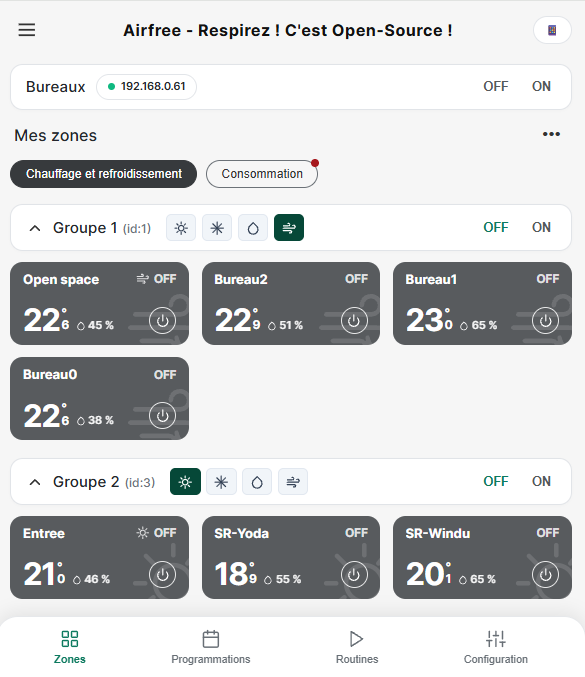

# Plugin Jeedom Airfree (`plugin-airfree`) — Respirez ! C'est Open-Source !

**Airfree** est un plugin **Jeedom** (Desktop, Dashboard & Mobile) permettant de piloter en **100 % local** les systèmes de régulation CVC via l'API locale sur le port TCP `3000` (`/api/v1/hvac`), sans abonnement Cloud requis.

> 💡 Vous cherchez l'application Web & Mobile autonome (sans Jeedom) ? Consultez le dépôt **[Renov-it/airfree](https://github.com/Renov-it/airfree)**.



---

## 🚀 Installation rapide dans Jeedom (via GitHub)

### Option 1 : Via l'interface Jeedom (Source GitHub)
1. Dans Jeedom, ouvrez **Réglages → Système → Configuration → onglet Mises à jour / Market**.
2. Cochez **Activer GitHub** dans la section *Sources de mise à jour*, puis cliquez sur **Sauvegarder**.
3. Allez dans **Plugins → Gestion des plugins → Ajouter depuis une autre source** :
   - **Type de source** : `GitHub`
   - **ID logique du plugin** : `airfree` *(important : doit être exactement `airfree`)*
   - **Utilisateur ou Organisation du dépôt** : `Renov-it`
   - **Nom du dépôt** : `plugin-airfree`
   - **Branche** : `master` *(ou `develop`)*
4. Cliquez sur **Enregistrer**, puis **Activer** le plugin.

### Option 2 : En ligne de commande SSH sur votre box Jeedom
```bash
cd /var/www/html/plugins
sudo git clone https://github.com/Renov-it/plugin-airfree.git airfree
sudo chown -R www-data:www-data /var/www/html/plugins/airfree
sudo chmod -R 775 /var/www/html/plugins/airfree
```
Puis activez le plugin dans **Plugins → Gestion des plugins → Airfree**.

---

## ⚙️ Configuration dans Jeedom

1. Dans la page du plugin (**Plugins →Gestion des plugins → Airfree**), renseignez :
   - **Adresse IP du Webserver Airfree** : ex. `192.168.0.61`
   - **Port API Locale** : `3000`
   - **IDs des Systèmes (Groupes)** : ex. `1,3`
2. Cochez **Afficher le panneau Desktop** et **Afficher le panneau Mobile**, puis cliquez sur **Sauvegarder**.
3. Cliquez sur **Découvrir & Synchroniser les zones** :
   - Un équipement Jeedom (`eqLogic`) est créé automatiquement pour chaque zone avec ses **18 commandes** (`Température`, `Consigne`, `Humidité`, `Mode`, `Marche`, `Arrêt`, `Demande Air`, `Demande Plancher`, `Minuterie Veille`...).
4. Accédez au panneau graphique complet via **Accueil → Airfree** (ou directement depuis **Plugins → Chauffage → Airfree**).

---

## 🔒 Sécurité & Conformité Jeedom

- **Authentification native Jeedom** : Toutes les requêtes passent par [`core/ajax/airfree.ajax.php`](core/ajax/airfree.ajax.php) protégé par `isConnect()` et `isConnect('admin')` pour les actions d'administration.
- **Protection Anti-SSRF** : Validation stricte des adresses IPv4 locales **RFC 1918** (`10.0.0.0/8`, `172.16.0.0/12`, `192.168.0.0/16`) et liste blanche stricte des endpoints (`/api/v1/hvac`, `/api/v1/webserver`, `/api/v1/version`, `/api/v1/integration`).
- **Protection XSS (`escapeHtml`)** : Échappement systématique des données dynamiques dans le DOM.

---

## 📄 Licence

Distribué sous licence **GNU GPL v3.0** — voir le fichier [LICENSE](LICENSE).
